# Nodelace for Node.js

Turn a small text file into architecture, flow, and sequence diagrams on your
own machine. Use the CLI in a terminal or call the async JavaScript API from
your application. Export SVG, self-contained HTML, or PNG with an optional browser.

**Node.js 22+ is the only required system runtime. No Python installation,
API key, AI model, or rendering service is required.**

## Save tokens with local rendering

**Generate diagrams locally with zero LLM API tokens.** Write a compact
`.diagram` file or edit one of the included examples. Nodelace handles layout,
connectors, fonts, and SVG/HTML generation on your machine. Optional PNG export
also runs locally. No LLM, API key, or per-token rendering charge is required.

- **Spend fewer tokens on diagram code:** let Nodelace produce the verbose SVG,
  HTML, styling, and coordinates. An optional AI assistant only needs to write
  the compact diagram source.
- **Regenerate without LLM costs:** edit labels, change themes or sizes, and
  export again without another model call. Batch generation works the same way.
- **Keep rendering local:** after installing the package and any optional PNG
  dependencies, rendering works offline and does not upload diagram content.

This can reduce token usage compared with asking an LLM to
generate and repeatedly rewrite complete diagram markup. Total savings depend
on your workflow; no measured savings percentage is claimed.

If you write the source yourself, the entire authoring-and-rendering workflow
needs no LLM tokens. If you choose AI-assisted authoring, that assistant's
prompts and responses still use tokens; Nodelace's rendering uses zero.
For efficient agent workflows, ask for compact diagram source and output file
paths, and keep generated SVG/font data out of the conversation.

This repository is a runnable guide for **Nodelace 0.3.0**. It installs the
[published npm package](https://www.npmjs.com/package/nodelace); the shared engine
is maintained in [nodelace](https://github.com/1aifanatic/nodelace). For Python,
see [nodelace-python](https://github.com/1aifanatic/nodelace-python).

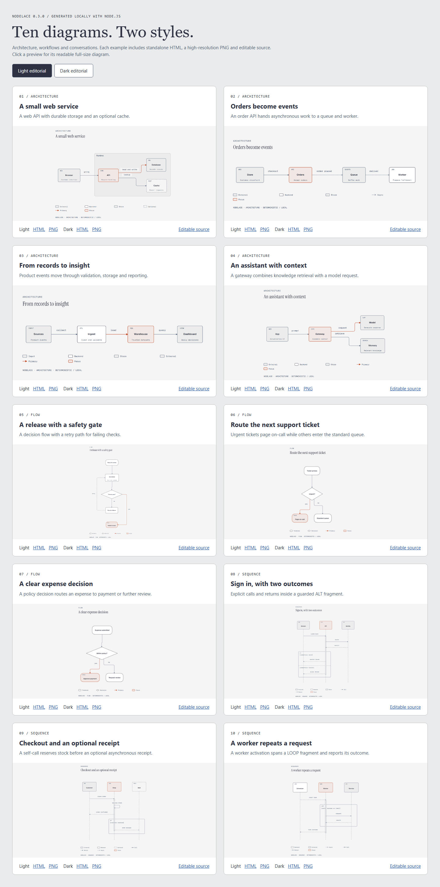

## Start in two minutes

Check your runtime, clone this guide, and install its pinned dependency:

```sh
node --version
git clone https://github.com/1aifanatic/nodelace-node.git
cd nodelace-node
npm ci
```

Generate your first diagram:

```sh
npx nodelace init architecture -o system.diagram
npx nodelace check system.diagram --layout --strict
npx nodelace render system.diagram --theme dark --format html
```

Open `system.html` in your browser. Edit `system.diagram`, then rerun the last
two commands. Installation downloads npm dependencies; subsequent rendering
works offline.

To add Nodelace to an existing Node.js project instead:

```sh
npm install nodelace@0.3.0
```

`npm install -g nodelace@0.3.0` also provides a global `nodelace` command.
Use `npx nodelace` with the project-local installation to keep versions reproducible.

## What you can create

| Diagram family | Useful for | Features demonstrated |
|---|---|---|
| Architecture | Service maps, infrastructure, event pipelines, assistant systems | Components, semantic roles, flat groups, labeled routes, feedback, highlights |
| Flow | Approvals, releases, support workflows, business decisions | Boxes, terminal/decision/merge shapes, branches, joins, retry paths |
| Sequence | API contracts, sign-in, checkout, background jobs | Calls, dashed returns, async messages, self-calls, activations, ALT/OPT/LOOP fragments |

All three families support light and dark themes. The
[style gallery](examples/styles/README.md) adds a custom color profile for each
family and examples of every canvas-size preset. These are the three supported
families; Nodelace does not implement every diagram type from the reference
design skill.

Typical integrations include documentation builds, design reviews, generated
release notes, CI artifacts, Node.js scripts, and backend diagram export jobs.
An AI assistant can write the compact source language while Nodelace handles
geometry, fonts, and rendering locally. Rendering uses no model tokens; prompt
writing, retries, and visual review still have their own costs.

## Ten complete examples

Every example contains editable source and **light/dark SVG, HTML, and PNG**.
The checked-in files are ready to view before you install anything.
GitHub displays PNG previews; download or clone the repository and open
[`examples/index.html`](examples/index.html) locally for the interactive gallery.
GitHub's HTML file viewer shows source rather than running the page.

| Preview | Example and source | Light | Dark |
|---|---|---|---|
| 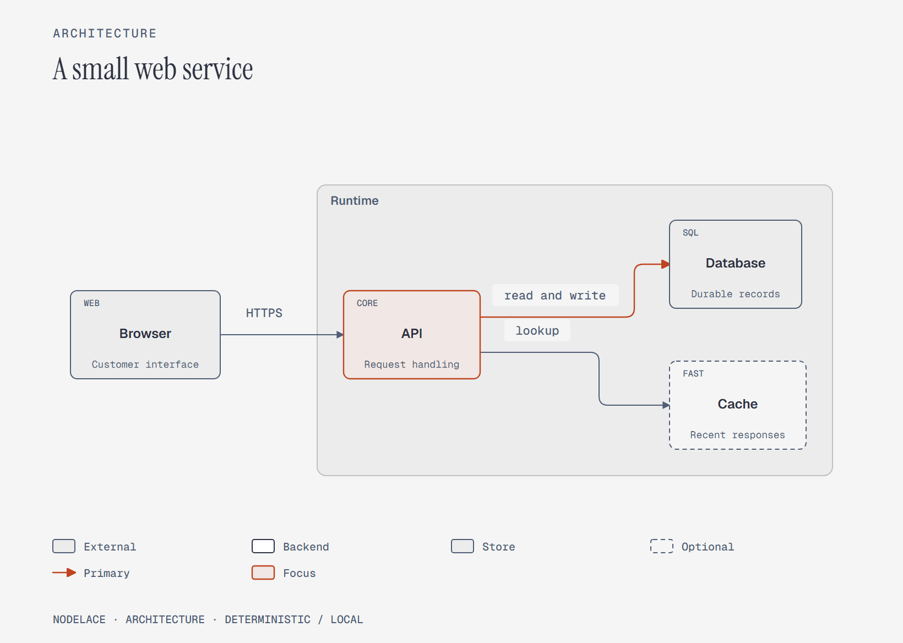 | [A small web service](examples/sources/01-web-service.diagram)<br>architecture | [SVG](examples/rendered/01-web-service-light.svg) / [HTML](examples/rendered/01-web-service-light.html) / [PNG](examples/rendered/01-web-service-light.png) | [SVG](examples/rendered/01-web-service-dark.svg) / [HTML](examples/rendered/01-web-service-dark.html) / [PNG](examples/rendered/01-web-service-dark.png) |
| 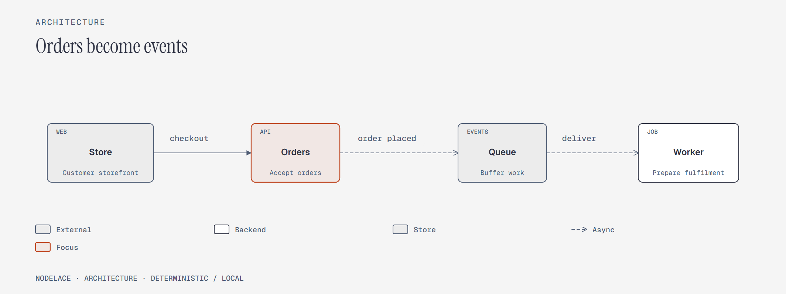 | [Orders become events](examples/sources/02-event-processing.diagram)<br>architecture | [SVG](examples/rendered/02-event-processing-light.svg) / [HTML](examples/rendered/02-event-processing-light.html) / [PNG](examples/rendered/02-event-processing-light.png) | [SVG](examples/rendered/02-event-processing-dark.svg) / [HTML](examples/rendered/02-event-processing-dark.html) / [PNG](examples/rendered/02-event-processing-dark.png) |
| 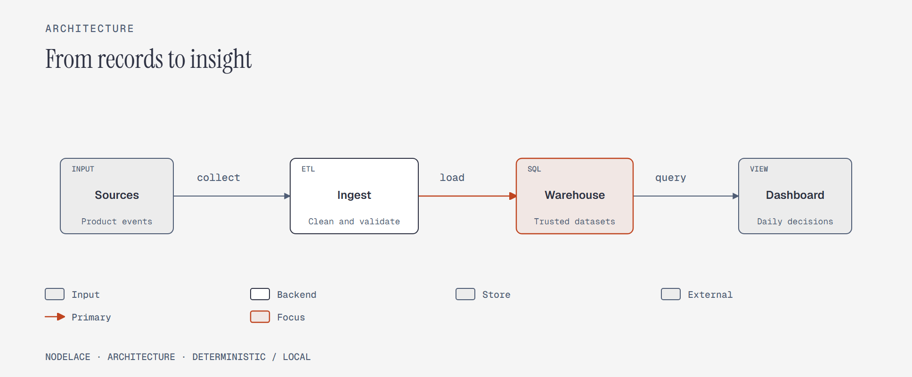 | [From records to insight](examples/sources/03-analytics-pipeline.diagram)<br>architecture | [SVG](examples/rendered/03-analytics-pipeline-light.svg) / [HTML](examples/rendered/03-analytics-pipeline-light.html) / [PNG](examples/rendered/03-analytics-pipeline-light.png) | [SVG](examples/rendered/03-analytics-pipeline-dark.svg) / [HTML](examples/rendered/03-analytics-pipeline-dark.html) / [PNG](examples/rendered/03-analytics-pipeline-dark.png) |
| 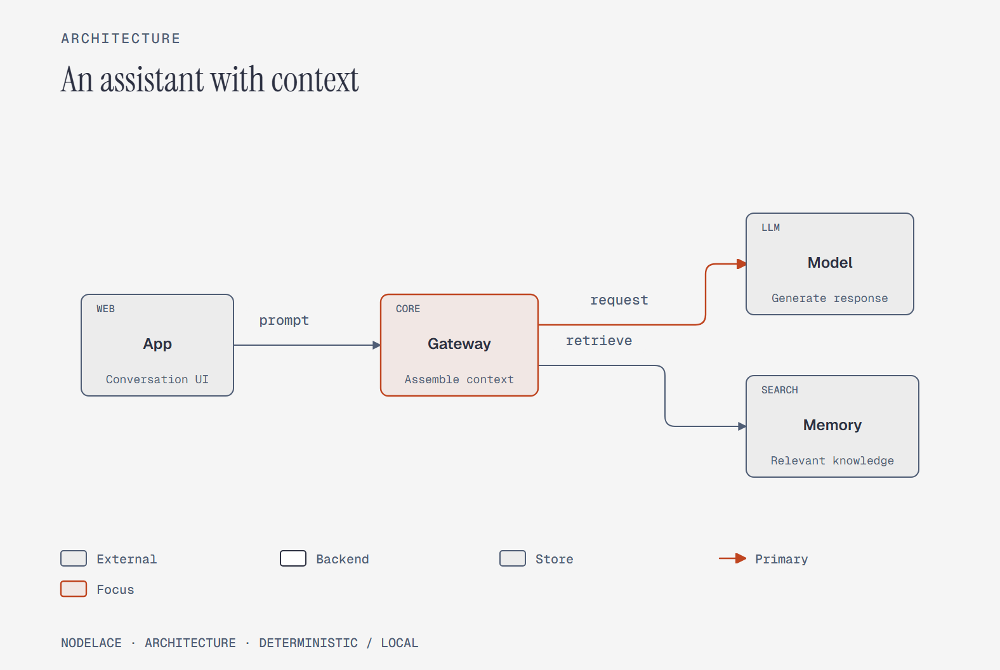 | [An assistant with context](examples/sources/04-assistant-architecture.diagram)<br>architecture | [SVG](examples/rendered/04-assistant-architecture-light.svg) / [HTML](examples/rendered/04-assistant-architecture-light.html) / [PNG](examples/rendered/04-assistant-architecture-light.png) | [SVG](examples/rendered/04-assistant-architecture-dark.svg) / [HTML](examples/rendered/04-assistant-architecture-dark.html) / [PNG](examples/rendered/04-assistant-architecture-dark.png) |
| 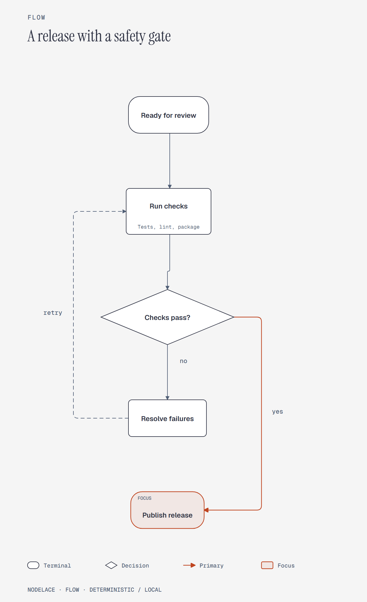 | [A release with a safety gate](examples/sources/05-release-gate.diagram)<br>flow | [SVG](examples/rendered/05-release-gate-light.svg) / [HTML](examples/rendered/05-release-gate-light.html) / [PNG](examples/rendered/05-release-gate-light.png) | [SVG](examples/rendered/05-release-gate-dark.svg) / [HTML](examples/rendered/05-release-gate-dark.html) / [PNG](examples/rendered/05-release-gate-dark.png) |
| 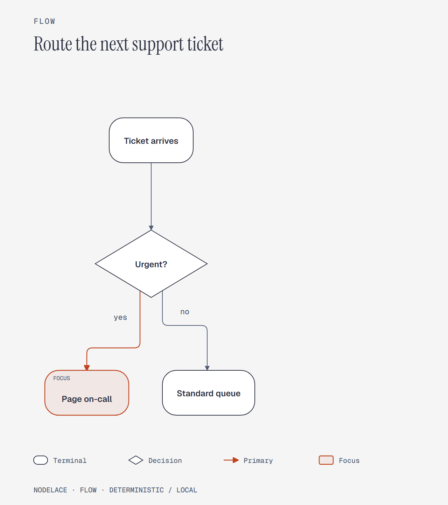 | [Route the next support ticket](examples/sources/06-support-triage.diagram)<br>flow | [SVG](examples/rendered/06-support-triage-light.svg) / [HTML](examples/rendered/06-support-triage-light.html) / [PNG](examples/rendered/06-support-triage-light.png) | [SVG](examples/rendered/06-support-triage-dark.svg) / [HTML](examples/rendered/06-support-triage-dark.html) / [PNG](examples/rendered/06-support-triage-dark.png) |
| 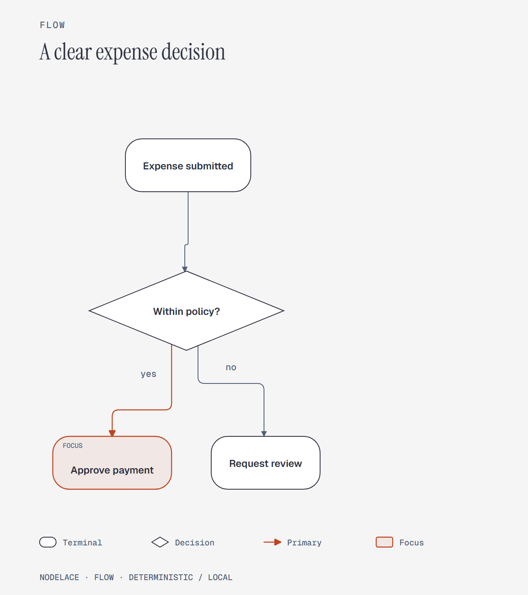 | [A clear expense decision](examples/sources/07-expense-approval.diagram)<br>flow | [SVG](examples/rendered/07-expense-approval-light.svg) / [HTML](examples/rendered/07-expense-approval-light.html) / [PNG](examples/rendered/07-expense-approval-light.png) | [SVG](examples/rendered/07-expense-approval-dark.svg) / [HTML](examples/rendered/07-expense-approval-dark.html) / [PNG](examples/rendered/07-expense-approval-dark.png) |
| 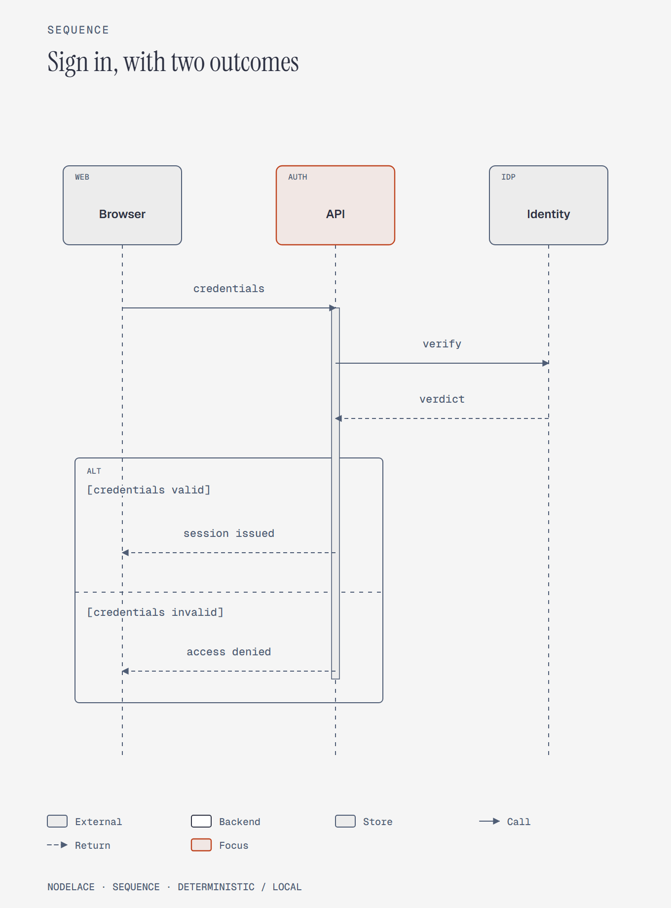 | [Sign in, with two outcomes](examples/sources/08-sign-in-sequence.diagram)<br>sequence | [SVG](examples/rendered/08-sign-in-sequence-light.svg) / [HTML](examples/rendered/08-sign-in-sequence-light.html) / [PNG](examples/rendered/08-sign-in-sequence-light.png) | [SVG](examples/rendered/08-sign-in-sequence-dark.svg) / [HTML](examples/rendered/08-sign-in-sequence-dark.html) / [PNG](examples/rendered/08-sign-in-sequence-dark.png) |
| 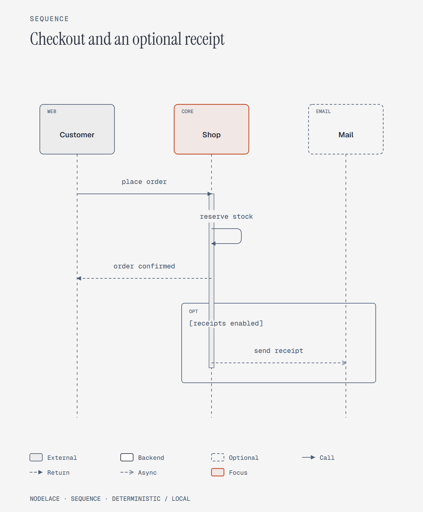 | [Checkout and an optional receipt](examples/sources/09-checkout-sequence.diagram)<br>sequence | [SVG](examples/rendered/09-checkout-sequence-light.svg) / [HTML](examples/rendered/09-checkout-sequence-light.html) / [PNG](examples/rendered/09-checkout-sequence-light.png) | [SVG](examples/rendered/09-checkout-sequence-dark.svg) / [HTML](examples/rendered/09-checkout-sequence-dark.html) / [PNG](examples/rendered/09-checkout-sequence-dark.png) |
| 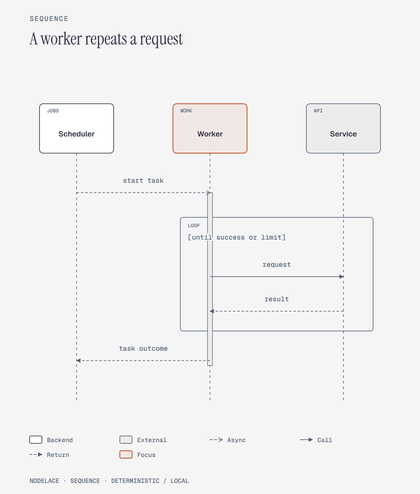 | [A worker repeats a request](examples/sources/10-worker-retry-sequence.diagram)<br>sequence | [SVG](examples/rendered/10-worker-retry-sequence-light.svg) / [HTML](examples/rendered/10-worker-retry-sequence-light.html) / [PNG](examples/rendered/10-worker-retry-sequence-light.png) | [SVG](examples/rendered/10-worker-retry-sequence-dark.svg) / [HTML](examples/rendered/10-worker-retry-sequence-dark.html) / [PNG](examples/rendered/10-worker-retry-sequence-dark.png) |

Regenerate the ten examples and the additional style gallery:

```sh
npm run check
npm run examples
```

`check` validates every variant without changing rendered files. Unexpected
warnings and all errors fail. The nested ALT/OPT style example deliberately
demonstrates the supported nesting syntax and records an expected `fragments`
editorial warning: prefer one frame for a simpler published diagram. Running
the package CLI's `--strict` check on that example exits with code 2.
`examples` updates the SVG and HTML files in `examples/rendered/`
and `examples/styles/rendered/`. The runner always uses paths relative to itself.
It intentionally replaces generated outputs; keep edits in `.diagram` sources.

```sh
npm run examples -- --offline
```

The offline option rejects JavaScript `fetch` calls during generation, providing
an extra regression check after dependencies are installed. PNG regeneration is
described below; the default command leaves existing PNG previews unchanged.

## Write diagram source

Save this UTF-8 text as `orders.diagram`:

```text
architecture "Order service"
node API role=backend tag=SERVICE sublabel="Order orchestration"
node Orders role=store
Browser -> API: HTTPS
API => Orders: commit
highlight API
```

Render either format:

```sh
npx nodelace render orders.diagram
npx nodelace render orders.diagram --format html --theme dark
```

The first command writes `orders.svg`; the second writes `orders.html`.
Derived sibling outputs are replaced on reruns. When you choose an explicit
output path, replacing an existing file requires `--force`:

```sh
npx nodelace render orders.diagram -o orders-dark.svg --theme dark --force
```

`init architecture`, `init flow`, and `init sequence` create starter files.
See the complete [source-language guide](docs/DSL.md) and the short
[agent reference](docs/AGENT-REFERENCE.md).

## Themes, profiles, and canvas sizes

Use `--theme light` or `--theme dark`. For a custom palette, create `colors.toml`:

```toml
[theme]
base = "light"
accent = "#2456a6"
accent_soft = "#e5edf8"
```

```sh
npx nodelace render orders.diagram --profile colors.toml
npx nodelace check orders.diagram --profile colors.toml --layout --strict
```

Profiles accept bounded color overrides; they are not arbitrary CSS. Choose
either a profile or a theme. The full color keys are `paper`, `surface`, `ink`,
`muted`, `accent`, `accent_soft`, `hairline`, `group_fill`, and `feedback`.
Each value is a six-digit hexadecimal color.

| Size | SVG canvas | Intended use |
|---|---|---|
| `fit` | Content-sized | Default, readable diagram |
| `doc-inline` | 960 × 600 | Documentation column |
| `doc-wide` | 1280 × 720 | Wide documentation |
| `slide-16x9` | 1280 × 720 | Presentation slide |
| `social-square` | 1080 × 1080 | Square image |
| `print-a4` | 1120 × 792 | A4 landscape proportions |

```sh
npx nodelace check orders.diagram --theme dark --size slide-16x9 --strict
npx nodelace render orders.diagram --theme dark --size slide-16x9
```

Use the same options for checking and rendering. Fixed canvases can shrink
dense diagrams; diagnostics warn about readability. HTML keeps diagram text
readable with a local horizontal scroll region on small screens. Use the browser
print dialog to save an HTML diagram as PDF; there is no native PDF export command.

## JavaScript API

Save JavaScript examples as `.mjs`, or use `"type": "module"` in `package.json`:

```js
import { writeFile } from 'node:fs/promises';
import { render, check, parse } from 'nodelace';

const source = 'architecture "Service"\nBrowser -> API: HTTPS';
const diagnostics = await check(source, { theme: 'dark' });
if (diagnostics.length) throw new Error(JSON.stringify(diagnostics));

const svg = await render(source, { theme: 'dark', idPrefix: 'service-map' });
await writeFile('service.svg', svg);
const model = await parse(source);
console.log(model.nodes.length);
```

Run the included [ES module example](examples/api.mjs):

```sh
npm run demo
```

The result is `output/api.svg` and `output/api.html`. The three public methods
return promises:

| Method | Result |
|---|---|
| `render(source, options)` | SVG or HTML string |
| `check(source, options)` | Layout diagnostic array; malformed source rejects |
| `parse(source)` | Parsed diagram model |

Render options are `format` (`svg` or `html`), `theme`, `size`, `idPrefix`,
`embedFonts`, and `profile`. API `profile` is **TOML text**, whereas the CLI
`--profile` takes a file path. `theme` and `profile` are mutually exclusive.
Fonts embed by default; set `embedFonts: false` or CLI `--system-fonts` to omit
them. Use distinct `idPrefix` values when embedding multiple SVGs in one page.

Catch `NodelaceError` to inspect its `code`, `line`, and `column`; syntax and
validation failures reject the promise. `check()` returns warnings and errors
for valid diagrams; callers decide whether to fail their build on either.

CommonJS callers can load the ESM package through `await import('nodelace')`:

```sh
node examples/api.cjs
```

### TypeScript

The package includes its own declarations. In a TypeScript project, import
`RenderOptions`, `Diagnostic`, or `Diagram` directly from `nodelace`. To compile
and run the included [typed example](examples/api.ts) from this repository:

```sh
npm install --save-dev typescript @types/node
npx tsc examples/api.ts --module NodeNext --target ES2022 --types node --outDir output/compiled
node output/compiled/api.js
```

This optional setup adds TypeScript tools to your local project. JavaScript and
CLI usage do not require them.

## PNG export

SVG and HTML need no browser. PNG export requires Playwright and Chromium:

```sh
npm install --no-save --package-lock=false playwright
npx playwright install chromium
npx nodelace export examples/sources/01-web-service.diagram -o web-service.png --theme dark --scale 2
```

The browser installation downloads Chromium. On a Linux machine missing system
libraries, use `npx playwright install --with-deps chromium` according to your
system's permission policy. Rendering runs locally and blocks HTTP(S) requests.
Scale can be an integer from 1 to 4; PNG output is limited to 64 million pixels.
Add `--force` to overwrite an existing explicit output.

To regenerate all included PNGs at 2× alongside SVG and HTML:

```sh
npm run examples:png
```

PNG is supported by the package CLI; `render()` itself returns SVG or HTML.
The gallery helper uses optional Playwright to screenshot the rendered SVGs.
`npm ci` removes dependencies installed with `--no-save`; reinstall Playwright
after a clean install when you need PNG again.

## Automation and deployment

Both the CLI and API work from Node.js build scripts and backend jobs. Input `-`
reads stdin; output `-` writes rendered text to stdout:

```sh
echo "Browser -> API" | npx nodelace render - -o - --system-fonts
npx nodelace check orders.diagram --layout --json
```

In the CLI, `check --layout` enables visual diagnostics. `--strict` implies
layout checks and also fails on warnings. Nonzero exit codes let CI stop before
publishing a problematic diagram. This repository includes a
[Node 22/24 GitHub Actions workflow](.github/workflows/examples.yml) that installs
dependencies, checks every example, and regenerates SVG/HTML with `fetch` disabled.

The package loads a local **Pyodide WebAssembly** runtime from `node_modules`.
It does not launch system Python. The runtime adds about 14 MB installed and
has cold-start overhead (about 1.8 seconds measured on the development machine;
your timing will vary). Keep the process alive to reuse the runtime. Rendering
is CPU-bound and serialized within a process; use a worker thread or job worker
when embedding it in a busy server. A browser-side editing SDK is not provided.

## Limits and troubleshooting

| Symptom | What to check |
|---|---|
| Unsupported Node version | Run `node --version`; use Node 22 or newer. |
| Cannot find `nodelace` | Run `npm ci` in this repository, or install the package in your project. |
| `Cannot use import statement` | Use `.mjs`, `"type": "module"`, or the CommonJS dynamic-import example. |
| PNG needs Playwright / browser executable missing | Install both the optional npm package and Chromium using the commands above. |
| Output already exists | Add `--force` for an explicit output path, or choose a new path. |
| Layout diagnostics | Shorten labels, split dense diagrams, or use `fit`; then inspect the result. |
| HTML appears as text on GitHub | Open the cloned HTML file in a browser. |
| Missing non-Latin glyphs | The viewer may need an appropriate system fallback font. |

The DSL supports at most 50 nodes, 200 edges, and 20 flat groups. The Node API
and CLI accept at most 256 KiB of source and 16 KiB of profile text. Groups do
not nest. Sequence fragments allow one nested level; full UML, swimlanes,
participant lifetimes, animation, and arbitrary CSS are outside this version.
Dense layouts still need human review. Unicode is accepted, but unsupported
font glyphs may look different across viewers. Layout diagnostics are useful
checks, not a guarantee of perfect composition.

Once installed, rendering uses no network, telemetry, or model calls. The same
input, options, and package version produce deterministic SVG/HTML. PNG pixels
also depend on Chromium and available fallback fonts. This implementation does
not claim 100% reproduction of the upstream design skill.

## Repository map and contributions

```text
examples/sources/       Ten editable diagram sources
examples/rendered/      Their light/dark SVG, HTML, and PNG files
examples/styles/        All families, custom colors, and every size preset
examples/index.html    Offline gallery
examples/api.*         Runnable ESM, CommonJS, and TypeScript integrations
scripts/               Batch checks and rendering
docs/                  DSL and compact agent reference
licenses/              Bundled-font license notices
```

Edit source files, run `npm run check` and `npm run examples`, and include changed
previews in a pull request. Run `npm run examples:png` if visual output changed.
Report guide problems in this repository and renderer bugs in the
[engine issue tracker](https://github.com/1aifanatic/nodelace/issues). Include
the package version, minimal `.diagram` source, options, and expected result.

## License and attribution

Guide code and examples use the [MIT License](LICENSE). Font bytes embedded in
the previews retain their [OFL notices](THIRD_PARTY_NOTICES.md). The npm package
and Pyodide retain their own distributed license notices.

Nodelace's design goals were inspired by Kathryn Lavery's
[diagram-design](https://github.com/cathrynlavery/diagram-design). The package is
an independent deterministic implementation and does not invoke that AI skill.
